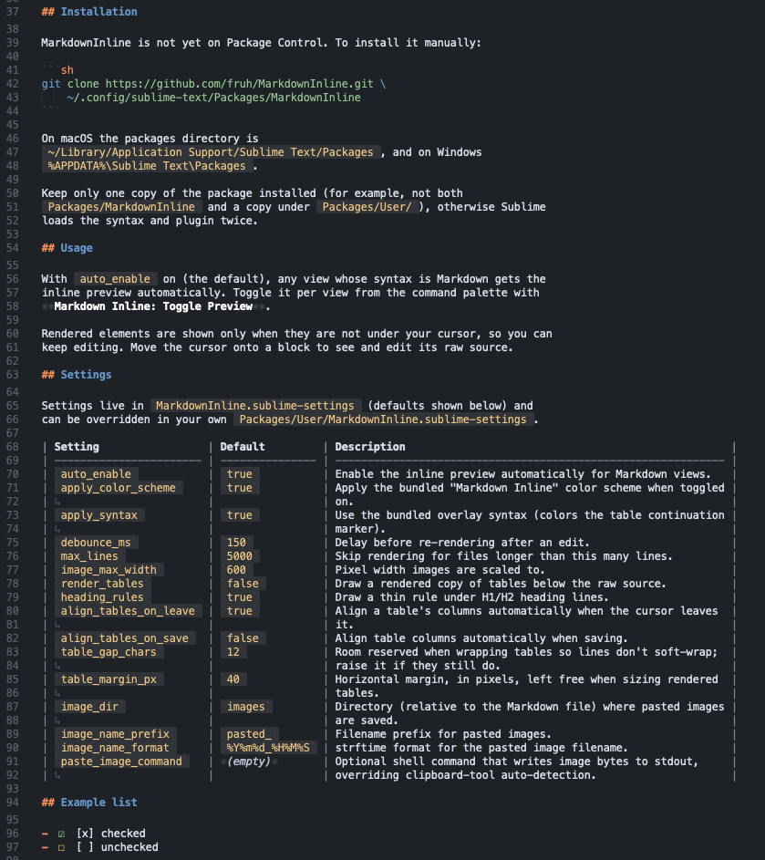

# MarkdownInline

Inline Markdown preview for [Sublime Text](https://www.sublimetext.com/).

MarkdownInline renders task checkboxes, local images, tables and heading rules
directly in your source file using phantoms, so you keep editing the raw
Markdown while seeing the result in place. Tables can be auto-aligned and the
bundled dark color scheme dims the noisy markup characters (`#`, `**`, `` ` ``,
`[]`, `()`).

Repository: https://github.com/fruh/MarkdownInline

## Features

- **Clickable task lists** — `- [ ]` / `- [x]` render as a checkbox you can
  click to toggle.
- **Local images** — `` renders inline for PNG, GIF and JPEG
  (and `file://` / relative paths), auto-scaled to fit `image_max_width`.
  Remote URLs are not fetched.
- **Paste images from the clipboard** — save a clipboard image (a screenshot, a
  file path, or a `data:` URI) into `images/` next to the file and insert a
  Markdown link. See [Pasting images](#pasting-images).
- **Heading and horizontal rules** — a thin rule is drawn under H1/H2 headings
  and after `---`. The rule hides while the cursor is on that line.
- **Table previews** — optionally draw a rendered copy of a table below the raw
  source (off by default; see `render_tables`).
- **Table auto-alignment** — pad and wrap tables into aligned columns when the
  cursor leaves the table and/or when saving.
- **Bundled color scheme** — a self-contained dark scheme that dims Markdown
  markers instead of hiding them.
- **Overlay syntax** — scopes the table continuation marker (`↳`) so it can be
  colored differently.
- **Non-blocking** — rendering runs asynchronously with a debounce, and is
  skipped entirely for files longer than `max_lines`.


## Installation

MarkdownInline is not yet on Package Control. To install it manually:

```sh
# linux
git clone https://github.com/fruh/MarkdownInline.git \
    "$HOME/.config/sublime-text/Packages/MarkdownInline"

# macos
git clone https://github.com/fruh/MarkdownInline.git \
    "$HOME/Library/Application Support/Sublime Text/Packages/MarkdownInline"
```

On macOS the packages directory is
`~/Library/Application Support/Sublime Text/Packages/MarkdownInline`, and on Windows
`%APPDATA%\Sublime Text\Packages\MarkdownInline`.

Keep only one copy of the package installed (for example, not both
`Packages/MarkdownInline` and a copy under `Packages/User/`), otherwise Sublime
loads the syntax and plugin twice.

## Usage

With `auto_enable` on (the default), any view whose syntax is Markdown gets the
inline preview automatically. Toggle it per view from the command palette with
**Markdown Inline: Toggle Preview**.

Rendered elements are shown only when they are not under your cursor, so you can
keep editing. Move the cursor onto a block to see and edit its raw source.

## Settings

Settings live in `MarkdownInline.sublime-settings` (defaults shown below) and
can be overridden in your own `Packages/User/MarkdownInline.sublime-settings`.

| Setting                 | Default         | Description                                                   |
| ----------------------- | --------------- | ------------------------------------------------------------- |
| `auto_enable`           | `true`          | Enable the inline preview automatically for Markdown views.   |
| `apply_color_scheme`    | `true`          | Apply the bundled "Markdown Inline" color scheme when toggled |
| ↳                       |                 | on.                                                           |
| `apply_syntax`          | `true`          | Use the bundled overlay syntax (colors the table continuation |
| ↳                       |                 | marker).                                                      |
| `debounce_ms`           | `150`           | Delay before re-rendering after an edit.                      |
| `max_lines`             | `5000`          | Skip rendering for files longer than this many lines.         |
| `image_max_width`       | `600`           | Pixel width images are scaled to.                             |
| `render_tables`         | `false`         | Draw a rendered copy of tables below the raw source.          |
| `heading_rules`         | `true`          | Draw a thin rule under H1/H2 heading lines.                   |
| `align_tables_on_leave` | `true`          | Align a table's columns automatically when the cursor leaves  |
| ↳                       |                 | it.                                                           |
| `align_tables_on_save`  | `false`         | Align table columns automatically when saving.                |
| `table_gap_chars`       | `12`            | Room reserved when wrapping tables so lines don't soft-wrap;  |
| ↳                       |                 | raise it if they still do.                                    |
| `table_margin_px`       | `40`            | Horizontal margin, in pixels, left free when sizing rendered  |
| ↳                       |                 | tables.                                                       |
| `image_dir`             | `images`        | Directory (relative to the Markdown file) where pasted images |
| ↳                       |                 | are saved.                                                    |
| `image_name_prefix`     | `pasted_`       | Filename prefix for pasted images.                            |
| `image_name_format`     | `%Y%m%d_%H%M%S` | strftime format for the pasted image filename.                |
| `paste_image_command`   | *(empty)*       | Optional shell command that writes image bytes to stdout,     |
| ↳                       |                 | overriding clipboard-tool auto-detection.                     |

## Pasting images

Press **Ctrl+Alt+V** (macOS: **Cmd+Alt+V**), or run **Markdown Inline: Paste
Image** from the command palette. The clipboard is inspected for an image and,
if one is found, saved into `image_dir` and inserted as a Markdown link:

```markdown

```

Three clipboard forms are supported:

- **File path / `file://` URI** — the file is copied into `image_dir`.
- **`data:` URI** — the embedded image is decoded and written to disk.
- **Raw clipboard image** (e.g. a screenshot) — read via an OS tool, since
  Sublime's clipboard API is text-only:
  - **macOS** works out of the box: the image is read with the built-in
    `osascript` (falling back to TIFF converted via `sips`). If `pngpaste` is
    installed it is used first.
  - **Linux** needs `wl-paste` (Wayland) or `xclip` / `xsel` (X11).
  - **Windows** uses the built-in PowerShell.

If no image is found, nothing is inserted and the status bar says so. If the
required Linux tool is missing, the message names it and hints at installing it.
You can also point the feature at your own command with `paste_image_command`
(e.g. `"/opt/homebrew/bin/pngpaste -"`). The file must be saved first so
`image_dir` has a base directory.

## Commands

Available from the command palette (**Ctrl/Cmd + Shift + P**):

- **Markdown Inline: Toggle Preview** — turn the inline preview on or off for
  the current view.
- **Markdown Inline: Align Table** — align the table under the cursor.
- **Markdown Inline: Align All Tables** — align every table in the file.
- **Markdown Inline: Paste Image** — save a clipboard image into `images/` and
  insert a Markdown link (bound to **Ctrl/Cmd+Alt+V**).
- **Markdown Inline: Debug** — print syntax, scope, scheme and rendering state
  to the Sublime console.

## Table continuation marker

When the aligner wraps a long cell onto several physical lines, the first cell
of each continuation line starts with `↳`. `table_rows()` joins those lines back
into a single logical row, so the marker never affects parsing and can be styled
independently.

## How it looks like


