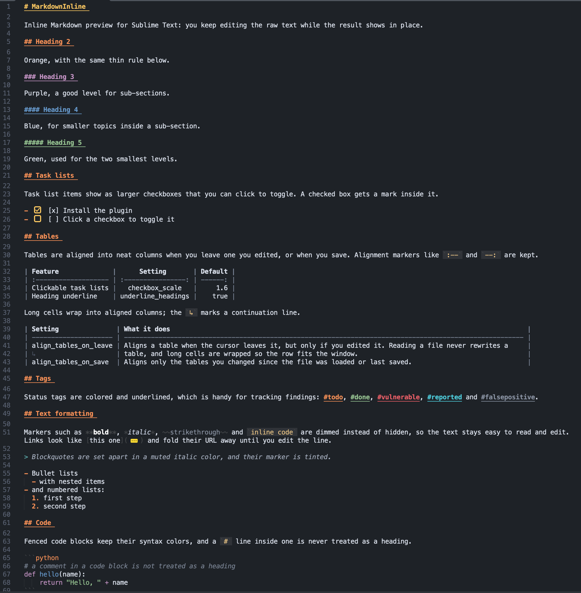

# MarkdownInline

Inline Markdown preview for [Sublime Text](https://www.sublimetext.com/).

MarkdownInline renders task checkboxes, local images, tables and heading rules
directly in your source file using phantoms, so you keep editing the raw
Markdown while seeing the result in place. Tables can be auto-aligned and the
bundled dark color scheme dims the noisy markup characters (`#`, `**`, `` ` ``,
`[]`, `()`).

Repository: https://github.com/fruh/MarkdownInline

## Features

- **Clickable task lists** — `- [ ]` / `- [x]` render as a checkbox you can
  click to toggle.
- **Local images** — `` renders inline for PNG, GIF and JPEG
  (and `file://` / relative paths), auto-scaled to fit `image_max_width`.
  Remote URLs are not fetched.
- **Paste images from the clipboard** — save a clipboard image (a screenshot, a
  file path, or a `data:` URI) into `images/` next to the file and insert a
  Markdown link. See [Pasting images](#pasting-images).
- **Heading and horizontal rules** — a thin rule is drawn under H1/H2 headings
  and after `---`. The rule hides while the cursor is on that line.
- **Collapsed links** — the URL of `[text](url)` links folds to `…`, so only the
  link text shows. It unfolds while the cursor is on the line. See `fold_links`.
- **Table previews** — optionally draw a rendered copy of a table below the raw
  source (off by default; see `render_tables`).
- **Table auto-alignment** — pad and wrap tables into aligned columns when the
  cursor leaves a table you edited (just reading never changes it) and/or when
  saving (only tables modified since the last load or save).
- **Bundled color scheme** — a self-contained dark scheme that dims Markdown
  markers instead of hiding them.
- **Overlay syntax** — scopes the table continuation marker (`↳`) so it can be
  colored differently.
- **Non-blocking** — rendering runs asynchronously with a debounce, and is
  skipped entirely for files longer than `max_lines`.


## Installation

MarkdownInline is not yet on Package Control. To install it manually:

```sh
# linux
git clone https://github.com/fruh/MarkdownInline.git \
    "$HOME/.config/sublime-text/Packages/MarkdownInline"

# macos
git clone https://github.com/fruh/MarkdownInline.git \
    "$HOME/Library/Application Support/Sublime Text/Packages/MarkdownInline"
```

On macOS the packages directory is
`~/Library/Application Support/Sublime Text/Packages/MarkdownInline`, and on Windows
`%APPDATA%\Sublime Text\Packages\MarkdownInline`.

Keep only one copy of the package installed (for example, not both
`Packages/MarkdownInline` and a copy under `Packages/User/`), otherwise Sublime
loads the syntax and plugin twice.

## Usage

With `auto_enable` on (the default), any view whose syntax is Markdown gets the
inline preview automatically. Toggle it per view from the command palette with
**Markdown Inline: Toggle Preview**.

Rendered elements are shown only when they are not under your cursor, so you can
keep editing. Move the cursor onto a block to see and edit its raw source.

## Settings

Settings live in `MarkdownInline.sublime-settings` (defaults shown below) and
can be overridden in your own `Packages/User/MarkdownInline.sublime-settings`.
Open both side by side via **Preferences → Package Settings → Markdown Inline →
Settings**, e.g. to stop aligning modified tables on save:

```json
{ "align_tables_on_save": false }
```

| Setting                 | Default         | Description                                                                         |
| ----------------------- | --------------- | ----------------------------------------------------------------------------------- |
| `auto_enable`           | `true`          | Enable the inline preview automatically for Markdown views.                         |
| `apply_color_scheme`    | `true`          | Apply the bundled "Markdown Inline" color scheme when toggled on.                   |
| `apply_syntax`          | `true`          | Use the bundled overlay syntax (colors the table continuation marker).              |
| `debounce_ms`           | `150`           | Delay before re-rendering after an edit.                                            |
| `max_lines`             | `20000`         | Skip rendering for files longer than this many lines.                               |
| `image_max_width`       | `600`           | Pixel width images are scaled to.                                                   |
| `render_tables`         | `false`         | Draw a rendered copy of tables below the raw source.                                |
| `checkbox_scale`        | `1.6`           | Checkbox size relative to the line height (1.0 ≈ half a line).                      |
| `checkbox_mark`         | `"check"`       | Mark inside a checked checkbox: `"check"` or `"cross"`.                             |
| `checkbox_offset_px`    | `0`             | Pixels checkboxes hang below the text baseline (moves down).                        |
| `underline_headings`    | `true`          | Underline all headings (H1-H6) in their heading color.                              |
| `highlight_tags`        | `true`          | Underline the tags #todo, #done, #vulnerable, #reported and #falsepositive in their |
| ↳                       |                 | color.                                                                              |
| `fold_links`            | `true`          | Fold link URLs to `…`; shown while the cursor is on the line.                       |
| `html_tags`             | `true`          | Enable the optional HTML-like tags (see below).                |
| `heading_rules`         | `true`          | Draw a thin rule under H1/H2 heading lines.                                         |
| `align_tables_on_leave` | `true`          | Align a table's columns when the cursor leaves it, only if it was edited.           |
| `align_tables_on_save`  | `true`          | When saving, align tables modified since the last load/save.                        |
| `table_gap_chars`       | `12`            | Room reserved when wrapping tables so lines don't soft-wrap; raise it if they still |
| ↳                       |                 | do.                                                                                 |
| `table_margin_px`       | `40`            | Horizontal margin, in pixels, left free when sizing rendered tables.                |
| `paste_image_on_paste`  | `true`          | Plain Cmd+V / Ctrl+V pastes a clipboard image when there is no text on the          |
| ↳                       |                 | clipboard.                                                                          |
| `image_dir`             | `images`        | Directory (relative to the Markdown file) where pasted images are saved.            |
| `image_name_prefix`     | `pasted_`       | Filename prefix for pasted images.                                                  |
| `image_name_format`     | `%Y%m%d_%H%M%S` | strftime format for the pasted image filename.                                      |
| `paste_image_command`   | *(empty)*       | Optional shell command that writes image bytes to stdout, overriding clipboard-tool |
| ↳                       |                 | auto-detection.                                                                     |

## Colors

The bundled color scheme is built from variables, so you can change a color
without editing the package. Open **Preferences → Package Settings → Markdown
Inline → Color Scheme** and put only the variables you want to change in your
own file on the right (`Packages/User/Markdown Inline.sublime-color-scheme`):

```json
{
    "variables": {
        "h1": "#ff6600",
        "h3": "#00aaff"
    }
}
```

Sublime merges it over the bundled scheme and reloads it right away.

| Variable            | Default   | Used for                 |
| ------------------- | --------- | ------------------------ |
| `h1`                | `#fac761` | H1 headings              |
| `h2`                | `#f99157` | H2 headings              |
| `h3`                | `#c594c5` | H3 headings              |
| `h4`                | `#6699cc` | H4 headings              |
| `h5_h6`             | `#99c794` | H5 and H6 headings       |
| `bold`              | `#ffffff` | bold text                |
| `italic`            | `#c0c8d8` | italic text              |
| `code`              | `#f0c987` | inline code              |
| `quote`             | `#a7b0c0` | blockquote text          |
| `quote_marker`      | `#5fb3b3` | the `>` of a blockquote  |
| `strike`            | `#8a93a3` | strikethrough text       |
| `list_marker`       | `#f99157` | list bullets and numbers |
| `tag_todo`          | `#f99157` | `#todo` tag              |
| `tag_done`          | `#99c794` | `#done` tag              |
| `tag_vulnerable`    | `#ec5f67` | `#vulnerable` tag        |
| `tag_reported`      | `#4fd1e0` | `#reported` tag          |
| `tag_falsepositive` | `#8a93a3` | `#falsepositive` tag     |
| `request_bg`        | `#5b9bd51f` | `<request>` block background |
| `response_bg`       | `#7fc77f1f` | `<response>` block background |
| `highlight_bg`      | `#fac761` | `<highlight>` background |
| `highlight_fg`      | `#1e2227` | `<highlight>` text       |

The scheme also defines `bg`, `fg`, `marker`, `table_border`, `link` and a few
more that can be overridden the same way. The checkbox color is drawn by the
plugin, so it is not part of the scheme.

### Tags

The tags `#todo` (orange), `#done` (green), `#vulnerable` (red), `#reported`
(cyan) and `#falsepositive` (grey) are colored and bold, with an underline in the
same color. The `#` has to start the word, so `# Heading`, `#anchor` in a URL,
inline code and code blocks are left alone. The text color comes from the
`tag_*` variables above; turn the underline off with `highlight_tags`.

## HTML-like tags

An optional module lets these tags look like their Markdown twins. The tags are
dimmed and nothing is rewritten or hidden:

| Tag                         | Same as           | Placement           |
| --------------------------- | ----------------- | ------------------- |
| `<code>text</code>`         | `` `text` ``      | one line            |
| `<bold>text</bold>`         | `**text**`        | one line            |
| `<codeblock>` … `</codeblock>` | a fenced block | own lines           |
| `<request>` … `</request>`  | code block, blue tint | own lines        |
| `<response>` … `</response>` | code block, green tint | own lines       |
| `<highlight>text</highlight>` | yellow highlight | one line, only inside `<codeblock>`, `<request>`, `<response>` |
| `<list>` … `</list>`        | bullet list       | each line is an item |
| `<olist>` … `</olist>`      | numbered list     | each line is an item |

Tags are case-insensitive and are recognised at the top level (not inside quotes
or other lists). The bullets and numbers are drawn as phantoms, so they are not
part of the text and hide while the cursor is on the line. Turn it off with
`html_tags`.

To remove the module for good, delete `Markdown Inline HTML.sublime-syntax` and
`html_tags.py`, the "HTML tags" rules and `request_bg` / `response_bg` /
`highlight_bg` / `highlight_fg` variables in the color scheme, then delete the lines marked `HTML-TAGS` in `plugin.py` (use
`SYNTAX` where `overlay_syntax()` is called), the `html_tags` setting and this
section.

## Pasting images

In a Markdown file, plain **Cmd+V** (Linux/Windows: **Ctrl+V**) pastes an image
when the clipboard holds an image and no text, for example after a screenshot.
Text is pasted as usual, and when there is no image the normal paste runs;
turn this off with `paste_image_on_paste`.

To paste an image explicitly, or to paste an image file path or `data:` URI as
an image, press **Ctrl+Alt+V** (macOS: **Cmd+Alt+V**), or run **Markdown Inline:
Paste Image** from the command palette. The clipboard is inspected for an image and,
if one is found, saved into `image_dir` and inserted as a Markdown link:

```markdown

```

Three clipboard forms are supported:

- **File path / `file://` URI** — the file is copied into `image_dir`.
- **`data:` URI** — the embedded image is decoded and written to disk.
- **Raw clipboard image** (e.g. a screenshot) — read via an OS tool, since
  Sublime's clipboard API is text-only:
  - **macOS** works out of the box: the image is read with the built-in
    `osascript` (falling back to TIFF converted via `sips`). If `pngpaste` is
    installed it is used first.
  - **Linux** needs `wl-paste` (Wayland) or `xclip` / `xsel` (X11).
  - **Windows** uses the built-in PowerShell.

Supported image formats are PNG, JPEG and GIF, recognised by their contents
rather than the file name. If no image is found, nothing is inserted and the
status bar says so. If the required Linux tool is missing, the message names it
and hints at installing it.
You can also point the feature at your own command with `paste_image_command`
(e.g. `"/opt/homebrew/bin/pngpaste -"`). The file must be saved first so
`image_dir` has a base directory.

### Changing the shortcut

A plugin setting can't change a key binding, so use Sublime's key bindings:
open **Preferences → Package Settings → Markdown Inline → Key Bindings** and add
your own entry on the right, for example:

```json
[
    { "keys": ["ctrl+shift+v"], "command": "markdown_inline_paste_image",
      "context": [{ "key": "selector", "operand": "text.html.markdown" }] }
]
```

To free the default keys, add the same keys with `"command": "noop"`. Plain
**Cmd+V** / **Ctrl+V** needs no binding; turn it off with `paste_image_on_paste`.

## Commands

Available from the command palette (**Ctrl/Cmd + Shift + P**):

- **Markdown Inline: Toggle Preview** — turn the inline preview on or off for
  the current view.
- **Markdown Inline: Align Table** — align the table under the cursor.
- **Markdown Inline: Align All Tables** — align every table in the file.
- **Markdown Inline: Paste Image** — save a clipboard image into `images/` and
  insert a Markdown link (bound to **Ctrl/Cmd+Alt+V**).
- **Markdown Inline: Debug** — print syntax, scope, scheme and rendering state
  to the Sublime console.

## Table continuation marker

When the aligner wraps a long cell onto several physical lines, the first cell
of each continuation line starts with `↳`. `table_rows()` joins those lines back
into a single logical row, so the marker never affects parsing and can be styled
independently.

## How it looks like



